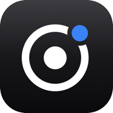
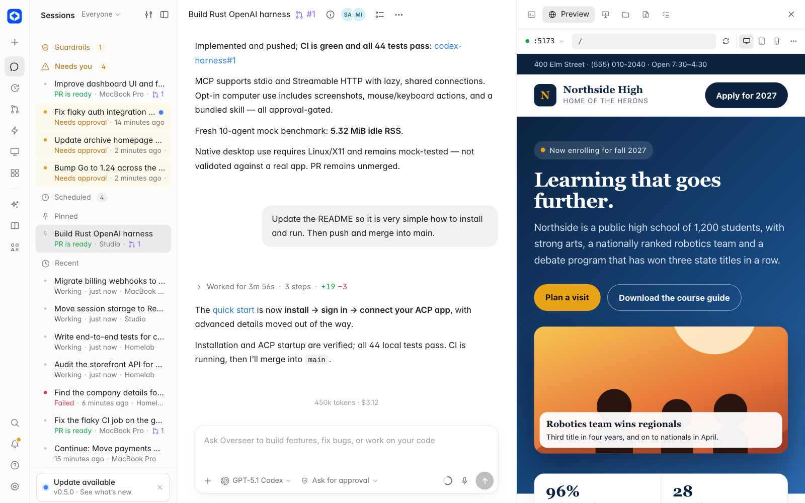
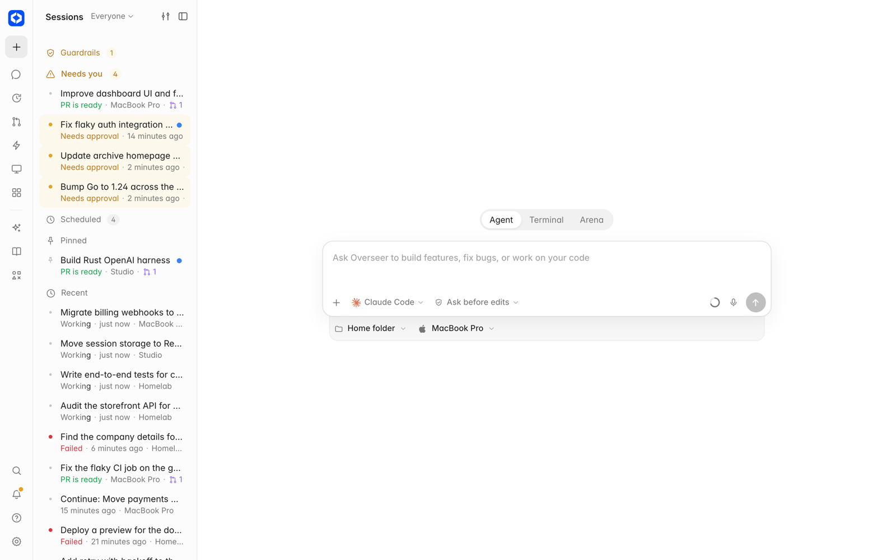
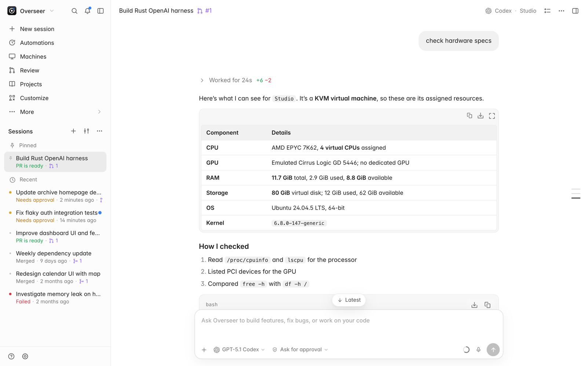
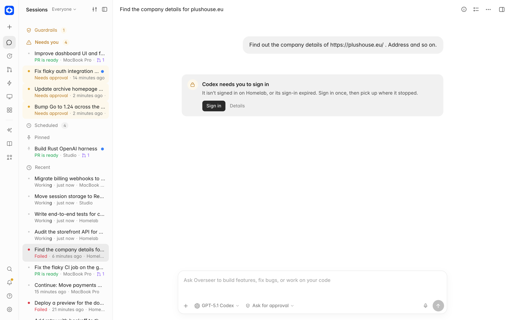
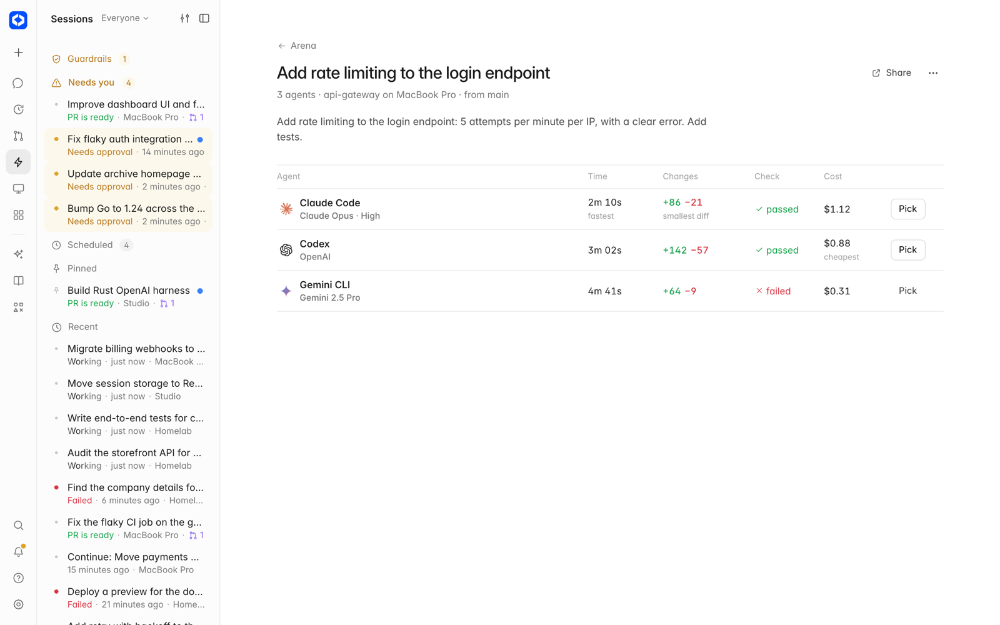
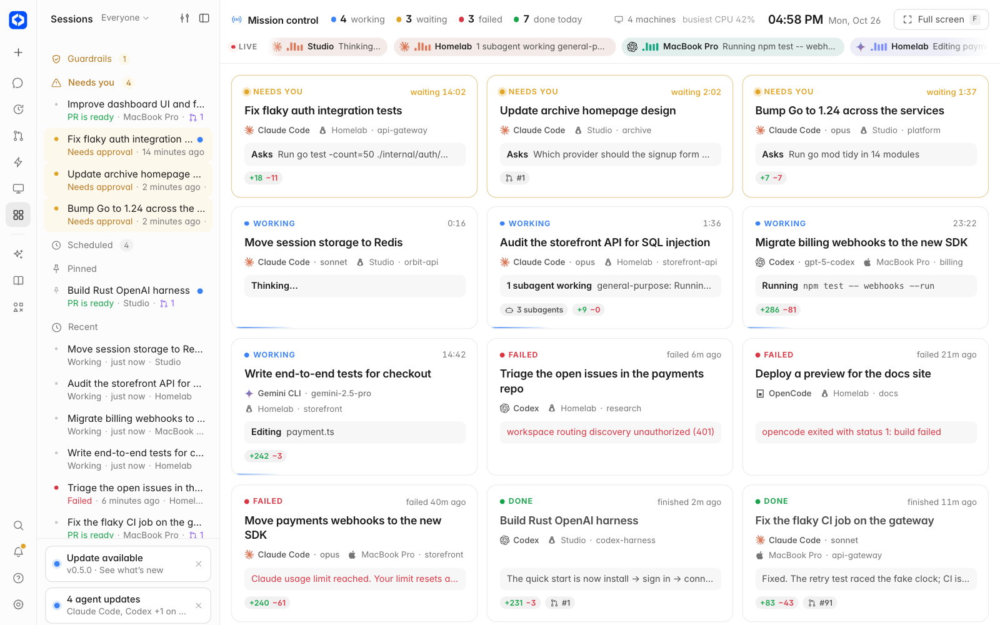
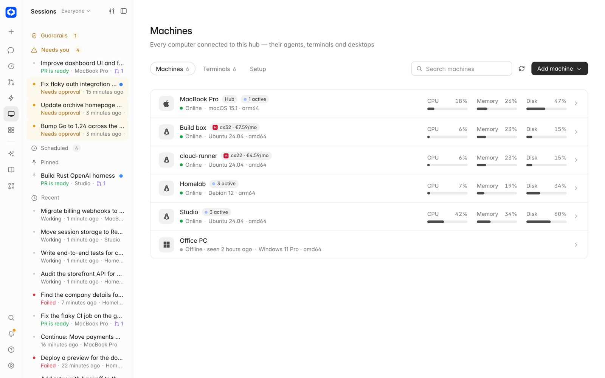
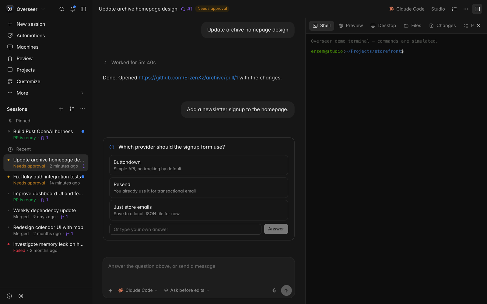

<div align="center">



# Overseer

**Your coding agents, on all your computers, in one browser tab.**

Run Claude Code, Codex, Gemini and other agents on your laptop, desktop,
homelab or cloud VMs, and watch, steer and review them from anywhere.

[Website](https://overseer.sh) · [Guide](docs/guide.md) · [Changelog](CHANGELOG.md) · [Releases](https://github.com/ErzenXz/overseer/releases)



</div>

## Install

Pick the computer that stays on most. It becomes your **hub**.

```sh
# Linux
curl -fsSL https://overseer.sh/install.sh | sh

# macOS
curl -fsSL https://overseer.sh/install-macos.sh | sh
```

```powershell
# Windows (PowerShell)
irm https://overseer.sh/install.ps1 | iex
```

Open the link it prints and choose a password. That’s it.

**Add your other computers:** go to **Machines → Add machine** and paste the
command it gives you on each one. They connect out to the hub, so there are no
ports to open or SSH keys to set up.

## What you can do

**Start a session.** Type what you want and send. Under the box, pick the
folder and the machine, or start straight from a GitHub repository and branch
(it gets its own worktree, so your work is never touched). Choose the agent,
model, thinking level, fast mode and how much it may do on its own. Attach
files and images by pasting or dragging them in.



**Follow along.** Steps fold into “Worked for 2m”, subagents show as their own
tree, edits show as diffs, and you approve, answer questions, steer, fork or
undo right in the chat, or from Telegram, Slack and Discord. Replies render
tables, code, math and diagrams as they stream.



**Sign in without leaving Overseer.** It knows when Claude Code or Codex is
signed out, opens the sign-in for you in a dialog, and turns a cryptic
`401 unauthorized` into a clear card with a button.



**See what it builds, live.** When an agent starts a dev server, open the
**Preview** tab and watch the site update as it works, from any device.
Changes show before and after screenshots.
[One-time setup](docs/guide.md#live-previews).


**Race agents.** Give one task to several agents in the **Arena**. Each works in
its own copy of the repo; compare the results and keep the winner.



**Watch everything.** **Mission control** is a live wall of every session,
grouped by what needs you, with a TV mode. Share a replay or a live view of any
session by link. `overseer top` does the same in a terminal.



**Use every machine.** Terminals, the full desktop, files and live stats for each
computer, from the browser. Add a Hetzner or DigitalOcean server in one step.



**Plan around your limits.** See your real plan limits, send a session for later
or for when a limit resets, hold or pause sessions before a subscription runs
dry, and continue a stuck session in another agent.

**Skills & plugins for every agent.** See and toggle the skills, plugins,
commands, subagents, rules, hooks and MCP servers of Claude Code, Codex, Devin
and more on each machine. Write a skill once and share it with all of them, or
install plugins from their marketplaces.

**Work as a team.** Invite people with owner, member or viewer roles, hand
sessions over, see who is looking, and keep an activity log.

**And more:** automations on a schedule or from labelled GitHub issues, pull
request review, any ACP agent detected automatically, keyboard shortcuts for
everything (press `?`), light and dark themes, and a layout that works on your
phone.



## Agents

| Agent | How Overseer talks to it |
|---|---|
| Claude Code | Its own stream-json protocol |
| Codex | `codex app-server` |
| Gemini CLI, OpenCode, Goose, Copilot CLI, Cursor and others | [Agent Client Protocol](https://agentclientprotocol.com) |

Install and sign in to them from **Machines → Setup** or the **Agents** tab of a
machine. Your credentials stay on each machine.

## Good to know

- **Private by default.** Reach your hub over [Tailscale](https://tailscale.com),
  Cloudflare Tunnel, or built-in HTTPS. Don’t expose plain HTTP to the internet.
- **Updates itself.** The hub and every machine update automatically, and you
  can roll back with one click in **Settings → General**.
- **Agents can drive it too.** Add Overseer as an MCP server and an agent can
  start and supervise other agents across your machines.

Everything else (install options, HTTPS, MCP, the CLI, updates) is in the
**[guide](docs/guide.md)**.

## Develop

```sh
git clone https://github.com/ErzenXz/overseer && cd overseer
make && ./overseer serve           # Go 1.25 + Node 20
cd ui && npm install && npm run dev   # UI with demo data at localhost:5173
```

MIT licensed.
