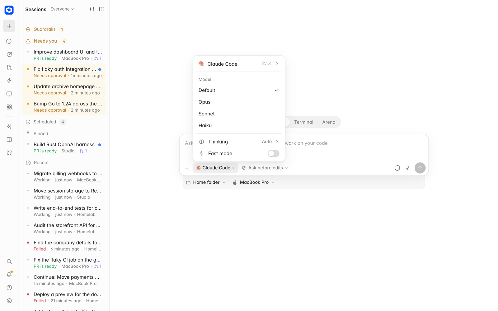

<div align="center">


# Overseer

**Your coding agents, on all your computers, in one browser tab.**

Run Claude Code, Codex, Gemini and other agents on your laptop, desktop,
homelab or cloud VMs, and watch, steer and review them from anywhere.

[Website](https://overseer.sh) · [Guide](docs/guide.md) · [Releases](https://github.com/ErzenXz/overseer/releases)


</div>

## Install

Pick the computer that stays on most. It becomes your **hub**.

```sh
# Linux
curl -fsSL https://overseer.sh/install.sh | sh

# macOS
curl -fsSL https://overseer.sh/install-macos.sh | sh
```

```powershell
# Windows (PowerShell)
irm https://overseer.sh/install.ps1 | iex
```

Open the link it prints and choose a password. That’s it.

**Add your other computers:** go to **Machines → Add machine** and paste the
command it gives you on each one. They connect out to the hub, so there are no
ports to open or SSH keys to set up.

## What you can do

**Start a session.** Type what you want, pick a machine and folder, and send.
Choose the agent, model, thinking level, fast mode and how much it may do on
its own.



**Follow along.** Steps fold into “Worked for 2m”, edits show as diffs, and you
approve, answer questions, steer, fork or undo right in the chat. Replies render
tables, code, math and diagrams as they stream.


**See what it builds, live.** When an agent starts a dev server, open the
**Preview** tab and watch the site update as it works, from any device.
[One-time setup](docs/guide.md#live-previews).

**Use every machine.** Terminals, the full desktop, files and live stats for each
computer, all from the browser.


**And more:** scheduled runs, MCP servers shared with every agent, pull request
review, light and dark themes, and a layout that works on your phone.


## Agents

| Agent | How Overseer talks to it |
|---|---|
| Claude Code | Its own stream-json protocol |
| Codex | `codex app-server` |
| Gemini CLI, OpenCode, Goose, Copilot CLI, Cursor and others | [Agent Client Protocol](https://agentclientprotocol.com) |

Install and sign in to them from **Machines → Setup**. Your credentials stay on
each machine.

## Good to know

- **Private by default.** Reach your hub over [Tailscale](https://tailscale.com),
  Cloudflare Tunnel, or built-in HTTPS. Don’t expose plain HTTP to the internet.
- **Updates itself.** The hub and every machine update automatically, and you
  can roll back with one click in **Settings → General**.
- **Agents can drive it too.** Add Overseer as an MCP server and an agent can
  start and supervise other agents across your machines.

Everything else (install options, HTTPS, MCP, the CLI, updates) is in the
**[guide](docs/guide.md)**.

## Develop

```sh
git clone https://github.com/ErzenXz/overseer && cd overseer
make && ./overseer serve           # Go 1.25 + Node 20
cd ui && npm install && npm run dev   # UI with demo data at localhost:5173
```

MIT licensed.
